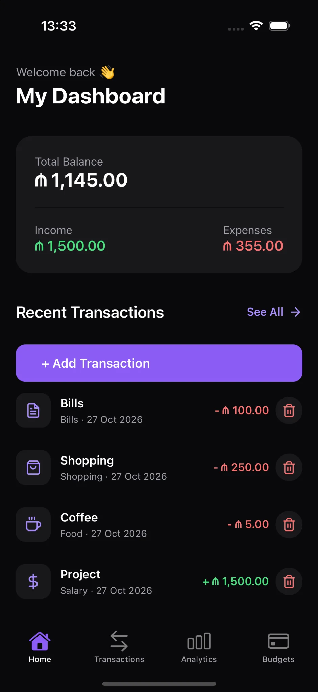
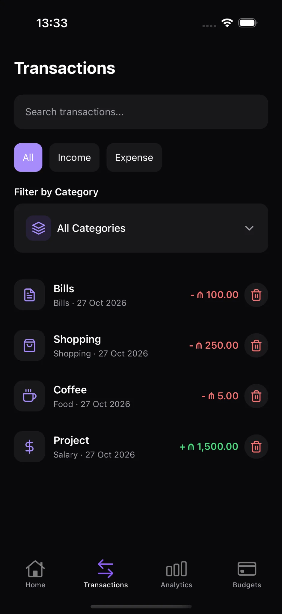
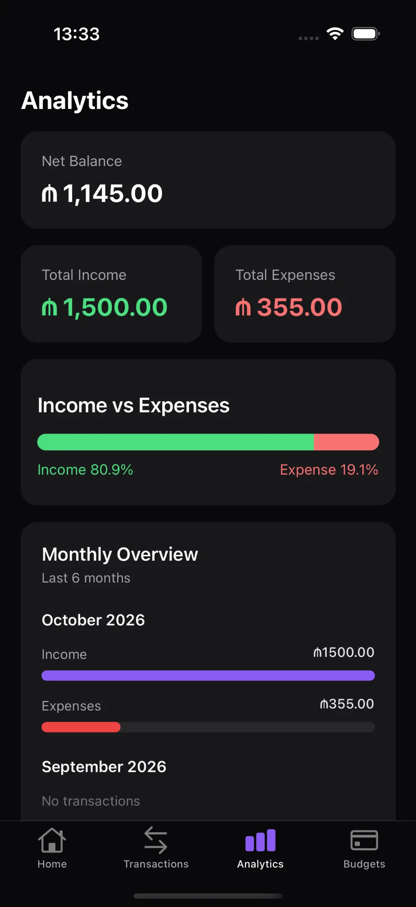
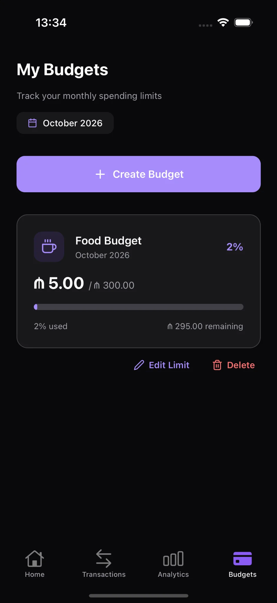
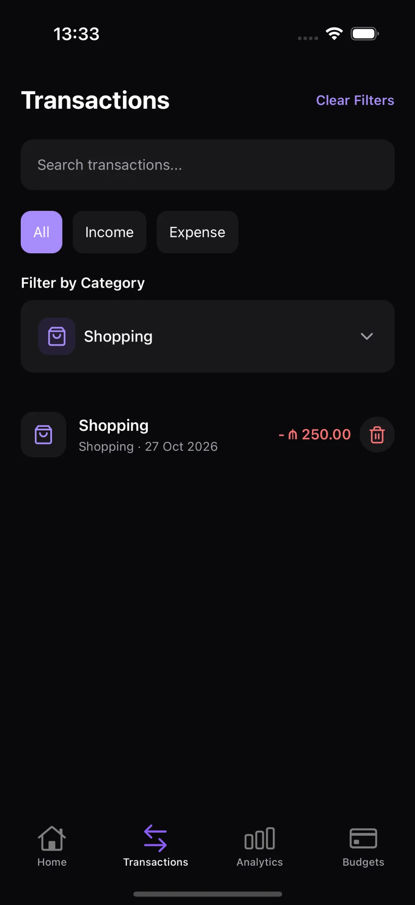
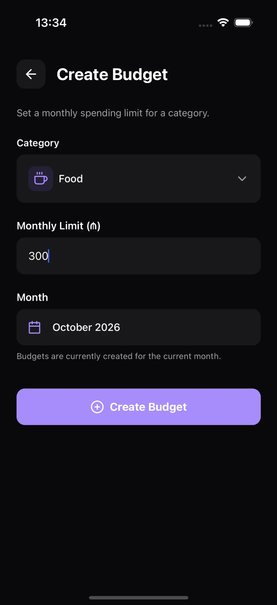

# FinTrack 💜

A modern, offline-first personal finance tracker built with React Native, Expo, and TypeScript.

FinTrack helps users manage their income, expenses, and monthly budgets through a clean, dark-themed mobile interface.

## Features

- **Dashboard:** View total balance, income, expenses, and recent transactions.
- **Transaction Management:** Add, edit, and delete income and expense records.
- **Categories:** Organize transactions by spending category.
- **Monthly Budgets:** Set category-based monthly spending limits.
- **Analytics:** Explore financial summaries and spending insights.
- **Local Persistence:** Store financial data on-device using Zustand and AsyncStorage.
- **Dark UI:** Modern mobile interface with purple accents.

## 📱 App Screenshots

Explore FinTrack's modern dark-themed interface.

### Dashboard & Transactions

|                                   Dashboard                                   |                                    Transactions                                     |
| :---------------------------------------------------------------------------: | :---------------------------------------------------------------------------------: |
|  |  |

### Analytics & Budgets

|                                   Analytics                                   |                                  Budgets                                  |
| :---------------------------------------------------------------------------: | :-----------------------------------------------------------------------: |
|  |  |

### Additional Screens

|                                    Transaction Filtering                                     |                                Create Budget                                 |
| :------------------------------------------------------------------------------------------: | :--------------------------------------------------------------------------: |
|  |  |

## Tech Stack

- React Native
- Expo & Expo Router
- TypeScript
- Zustand
- AsyncStorage
- Lucide Icons

## Getting Started

### Prerequisites

- Node.js
- npm
- Expo Go or an iOS/Android simulator

### Installation

```bash
git clone https://github.com/EmilNaghizade/FinTrack.git
cd FinTrack
npm install
npx expo start
```

## Project Status

**v1.0 — Offline MVP**

FinTrack currently stores data locally on the device and does not require an account.

Cloud synchronization and authentication may be considered in a future release.

## Author

Built as a React Native portfolio project.

## License

No open-source license has been assigned yet.
